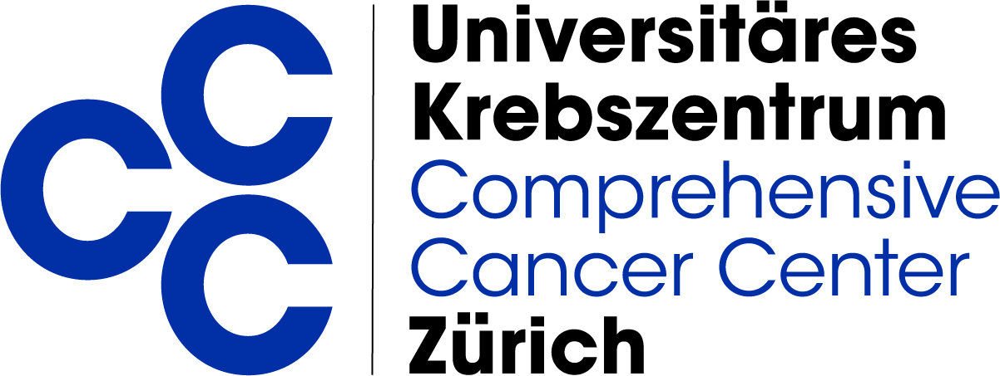

# Publication-Ready Figure Generation in R

A hands-on 2 half-day course covering effective data visualization principles and practical techniques for creating publication-ready figures in R.
Designed for researchers at the Comprehensive Cancer Center Zurich (CCCZ), University Hospital Zurich (USZ), and University of Zurich (UZH).

## Acknowledgements

| | |
|---|---|
|  |  |
| We thank [Prof. Michael Krauthammer](https://krauthammerlab.ch/authors/michaelkrauthammer/) for supporting this course. | Special thanks to **CCCZ** — Dr. Maja Zenz and Ms. Silke Uflacker — for providing coffee breaks. |

---

**Instructor:** Deepak Tanwar — [deepak.tanwar@uzh.ch](mailto:deepak.tanwar@uzh.ch)

---

## Course Format

| | |
|---|---|
| **Format** | 2 half-day intensive workshop |
| **Duration** | 4 hours per half-day (8 hours total) |
| **Audience** | Researchers with basic R programming skills |
| **Prerequisites** | See [setup.md](setup.md) — complete before the course |

---

## Learning Objectives

- **Analyze the principles of effective data visualization:**
  - **Explain** the importance of clarity, accuracy, and aesthetics in creating publication-ready figures.
  - **Identify** common pitfalls in data visualization and how to avoid them.

- **Apply base R graphics for figure creation:**
  - **Create** basic plots (e.g., scatterplots, bar charts, histograms) using base R functions like `plot()`, `barplot()`, and `hist()`.
  - **Customize** plots with titles, labels, legends, and color schemes.

- **Construct advanced visualizations using ggplot2:**
  - **Build** complex and layered visualizations using the `ggplot2` package.
  - **Apply** themes, scales, and `geoms` to create polished and publication-ready figures.

- **Adapt figures for specific publication requirements:**
  - **Adjust** figure dimensions, resolutions, and formats (e.g., PDF, PNG, TIFF) for journal submissions.
  - **Modify** fonts, line weights, and other stylistic elements to meet publication guidelines.

- **Integrate statistical annotations and summaries:**
  - **Add** statistical summaries (e.g., regression lines, confidence intervals) to figures.
  - **Annotate** plots with p-values, correlation coefficients, or other relevant statistics.

- **Generate high-quality figures:**
  - **Use** functions like `ggsave()` or `pdf()` to export figures in high resolution.
  - **Ensure** exported figures meet the technical requirements of target journals or platforms.

- **Assemble multi-panel figures:**
  - **Combine** multiple plots into a single figure using tools like `patchwork`.
  - **Align** and **arrange** subplots to effectively communicate complex data.

- **Implement best practices for reproducibility:**
  - **Write** clean and reusable R scripts for figure generation.
  - **Document** code and workflows to ensure reproducibility and transparency.

---

## Course Schedule

| Half-Day | Time | Session | Topics | Exercises |
|----------|------|---------|--------|-----------|
| **Morning (Day 1)** | 09:00–09:15 | Welcome | Introductions, course overview | — |
| | 09:15–10:15 | **Block 1: Visualization Principles** | Why figures matter, clarity vs. complexity, common mistakes | Ex 1 |
| | 10:15–10:30 | *Break* | | |
| | 10:30–12:00 | **Block 2 & 3: Base R + ggplot2 Fundamentals** | `plot()`, layers, aesthetics, `geoms`, basic plots | Ex 2, Ex 3 |
| **Afternoon (Day 1)** | 13:00–14:30 | **Block 4: Styling & Themes** | Scales, themes, annotations, legends | Ex 4 |
| | 14:30–14:45 | *Break* | | |
| | 14:45–16:00 | **Block 5: Publication Standards** | Figure formats, resolution, dimensions, journal requirements | Ex 5 |
| **Morning (Day 2)** | 09:00–10:30 | **Block 6: Multi-panel Figures** | `patchwork`, layout, alignment, combined plots | Ex 6 |
| | 10:30–10:45 | *Break* | | |
| | 10:45–12:00 | **Block 7: Advanced Topics** | Statistical overlays, faceting, final tips | Ex 7 |
| **Afternoon (Day 2)** | 13:00–15:30 | Final Project | Create publication-ready figure(s) from provided data | — |
| | 15:30–16:00 | Wrap-up & Feedback | Q&A, certificate, next steps | — |

---

## Project Structure

This project is structured as follows:

- `_quarto.yml`: Configuration file for Quarto.
- `index.qmd`: The main page of the course website, containing learning objectives and course overview.
- `qmd/`: Directory containing Quarto markdown files for course content, setup guides, and cheat sheets.
- `slides/`: Directory containing Quarto markdown files for presentation slides (Blocks 1–7).
- `exercises/`: Directory containing Quarto markdown files for exercises and the final project.
- `styles.css`: Custom CSS for styling the website.
- `docs/`: Directory where the rendered website is built.

---

## Prerequisites

**Basic R Programming Skills:**
- Understanding R syntax (objects, functions, operators)
- Ability to create and manipulate basic data structures: vectors, factors, data frames, and lists
- Familiarity with indexing and subsetting data
- Writing simple scripts in RStudio or another R IDE
- Reading and importing data (`read.csv()`, `read.table()`, or `readr`)

You can evaluate your skills here:
- [Google Form](https://docs.google.com/forms/d/e/1FAIpQLSdIyeuabd_ZOWXgI1MWHapmaOMu20L9ESkLDZiWnpmkpujyOg/viewform)
- [Coursera R Programming Skill Assessment](https://www.coursera.org/resources/r-programming-skill-assessment)
- [NCEAS R Review and Assessment](https://nceas.github.io/oss-lessons/r-review-and-assessment/r-review-and-assessment.html)

---

## Computational Requirements

- **R** 4.5.1 or later
- **RStudio** (latest version recommended)
- **renv** R package installed for reproducible environments
  - See: [renv documentation](https://rstudio.github.io/renv/articles/renv.html)

---

## Build Instructions

To build this course website locally, follow these steps:

1. **Install Quarto:** If you don't have Quarto installed, follow the instructions on the [Quarto website](https://quarto.org/docs/get-started/).

2. **Clone the repository:**
   ```bash
   git clone https://github.com/DQBM-CCCZ/publication_ready_figs_R.git
   cd publication_ready_figs_R
   ```

3. **Restore the R environment** (optional, but recommended):
   ```r
   renv::restore()
   ```

4. **Render the website:** Open the project in RStudio and run the following command in the R console, or execute it in your terminal:
   ```bash
   quarto render
   ```
   This will generate the `docs/` directory containing the static website.

5. **Preview the website:** Open `docs/index.html` in your web browser to view the local build.

---

## Contributing

Contributions are welcome! Please see the [CONTRIBUTING.md](CONTRIBUTING.md) file for details.

## License

This project is licensed under the MIT License. See the [LICENSE](LICENSE) file for details.

---

Visit the course website: [https://dqbm-cccz.github.io/publication_ready_figs_R/](https://dqbm-cccz.github.io/publication_ready_figs_R/)

Access slides, exercises, and resources there.